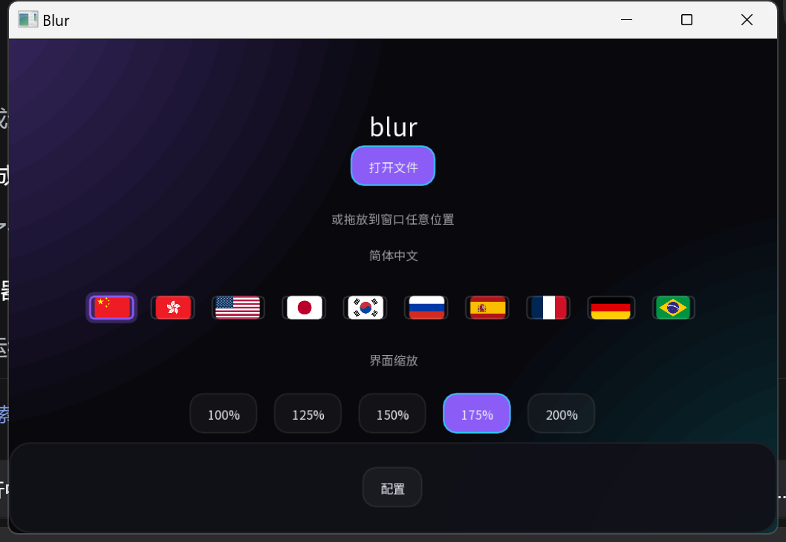

# blur · multilingual UI build

[简体中文](README.md) | **English** | [繁體中文](README.zh-TW.md) | [日本語](README.ja.md)

An open-source tool that adds motion blur to videos. It interpolates the clip to a
very high frame rate and averages frames over time, which looks close to a real
long exposure.

This repository is a **third-party fork of [f0e/blur](https://github.com/f0e/blur) v2.45**.
The rendering pipeline is untouched; the interface was redesigned and made multilingual.

[](docs/screenshots/home.png)

## What is different from upstream

| | upstream f0e/blur | this fork |
| --- | --- | --- |
| Rendering | — | **unchanged** (same `rendering.cpp` / `vapoursynth/*.py`) |
| UI | English, fixed 13px text | redesigned (violet/cyan glass) + high-DPI aware |
| Languages | English | 10: 简中 / 繁中 / English / 日本語 / 한국어 / Русский / Español / Français / Deutsch / Português |
| Interface zoom | none | 100% / 125% / 150% / 175% / 200%, switchable on the home screen, follows the display scale by default |
| Preview | stale preview from the last run | cleared on every start |
| Auto update | enabled | disabled (so it is not replaced by the upstream English build) |

## Download

Grab one of these from [Releases](https://github.com/SORA123k/blur/releases):

| Type | File | Difference |
| --- | --- | --- |
| **Installer** (recommended) | `blur-v2.45-multilingual-setup-win64.exe` | **Asks where to install with a folder picker** (default `%LOCALAPPDATA%\Programs\blur`, any drive works), **no admin rights**, nothing else to install; then asks whether to create a **desktop shortcut** (on by default); registers in "Settings → Apps → Installed apps". |
| **Portable** | `blur-v2.45-multilingual-portable-win64.zip` | Unzip anywhere (avoid non-ASCII paths), run `blur-gui.exe`. No registry writes, no shortcuts, delete the folder to remove. |

Both carry every runtime dependency (FFmpeg, VapourSynth, RIFE models, fonts) — install and go, nothing else needed.

Installer details:

- **You choose the install folder** (default `%LOCALAPPDATA%\Programs\blur`, creates a `blur` subfolder inside it)
- Asks once whether to create a desktop shortcut; "No" leaves only the start menu shortcut
- Uninstall from Settings → Apps → Installed apps → blur (same as running `uninstall.cmd`)
- Unattended: `setup.exe /S /D="D:\Games\blur"` (optionally `--no-desktop-shortcut`)

### Requirements

- Windows 10 1803+ / Windows 11, x64
- RIFE interpolation needs a Vulkan capable GPU; **if none is detected it falls back to SVP automatically and tells you** (CPU works too, just slower). Your config keeps RIFE.
- The installer uses the bundled `tar.exe` (Windows 10 1803+); older systems should use the portable zip

## Fixed in this fork

- Interface language / real flag picker / UI scaling / preview cleanup (see above)
- **Non-ASCII paths**: a video whose name is not ASCII used to crash the CLI (0xC0000409), and installing under a
  non-ASCII path (a Chinese user name, for example) made `rife_model` break the settings JSON with
  `type_error.316`. Both are fixed and verified: renders from a Chinese-named clip and from a Chinese install path.

## Usage

1. Drop a video onto the window, or press **Open file**
2. Pick your language (flag) and interface zoom on the home screen
3. Press **Configuration** to tune the parameters

Sensible first settings: output fps 60, blur amount 1, weighting `equal`, interpolation on (1200fps), deduplication on.
The result is written next to the source video.

## Building

Full guide: [docs/BUILD.md](docs/BUILD.md). Short version:

```bash
# Needs Visual Studio 2022 (Desktop C++), Windows SDK, CMake, Ninja, vcpkg
git clone --recursive https://github.com/SORA123k/blur.git
cd blur
cmake -S . -B build -G Ninja \
  -DCMAKE_BUILD_TYPE=Release \
  -DCMAKE_TOOLCHAIN_FILE="$VCPKG_ROOT/scripts/buildsystems/vcpkg.cmake" \
  -DVCPKG_TARGET_TRIPLET=x64-windows-static
cmake --build build
```

> A **static triplet is mandatory**: the project hardcodes `BOOST_FILESYSTEM_STATIC_LINK`
> and the static CRT, so the dynamic `x64-windows` triplet fails to compile.
> The source path must not contain non-ASCII characters (`rc.exe` is an ANSI tool).

`.github/workflows/build.yml` builds both packages on every tag.

## Layout

```
src/                  sources (common = core + config, gui = interface, cli = command line)
  common/i18n.cpp     language tables and switching
  common/i18n_table.h generated from translations/*.tsv
  gui/ui/theme.h      design tokens (colours, radii) — change this file to reskin
  gui/ui/flags.h      embedded real flag PNGs
  gui/fonts/cn_sans.h embedded font subset (latin/cyrillic/kana/hangul/CJK)
translations/         the ten language .tsv files
dependencies/         imgui + stb, vendored (no submodules needed)
docs/                 build guide and screenshots
```

To change a translation, edit `translations/lang_*.tsv` and run `python tools/gen_i18n.py`
to regenerate `src/common/i18n_table.h`.

## Licence and credits

- **GPL-3.0**, same as upstream — see [LICENSE](LICENSE).
- Upstream: [f0e/blur](https://github.com/f0e/blur) by **f0e**. This is an unofficial fork with no
  affiliation or endorsement; please do not report this fork's issues upstream.
- Third-party components and font licences: [THIRD-PARTY-NOTICES.txt](THIRD-PARTY-NOTICES.txt) and `LICENSES/`.
- UI fonts: Noto Sans SC + Noto Sans KR subsets (SIL OFL 1.1).
- Flags: [flagcdn.com](https://flagcdn.com) (public domain, from Wikimedia Commons).
- UI style based on the clickgui-ui design tokens.

## Disclaimer

Provided as-is, without warranty (GPL-3.0 §15/§16). This is a video processing tool; it does not
provide, contain or help obtain any game assets, cheats or cracks. You are responsible for the
rights to the footage you process.
