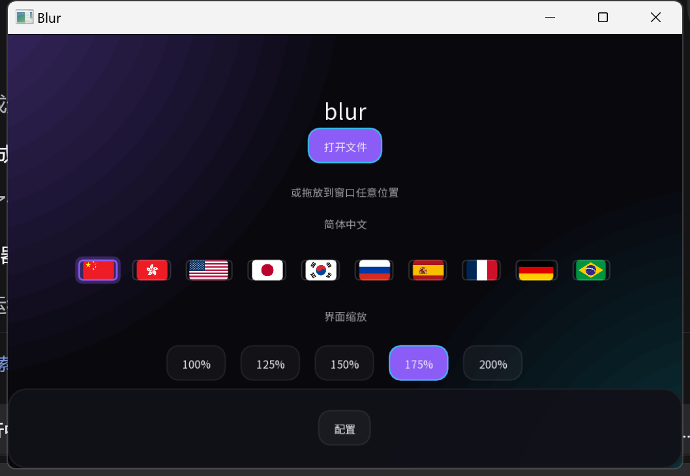

# blur · 多言語 UI 版

[简体中文](README.md) | [English](README.en.md) | [繁體中文](README.zh-TW.md) | **日本語**

動画にモーションブラーをかけるオープンソースツールです。超高フレームレートまで補間してから時間方向に平均化するため、実際の長時間露光に近い見た目になります。

このリポジトリは **[f0e/blur](https://github.com/f0e/blur) v2.45 のサードパーティ fork** です。レンダリング処理は変更せず、UI の刷新と多言語化のみを行っています。

[](docs/screenshots/home.png)

## 上流との違い

| | 上流 f0e/blur | この fork |
| --- | --- | --- |
| レンダリング | — | **変更なし** |
| UI | 英語・13px 固定 | 再設計（紫／シアンのグラス調）+ 高 DPI 対応 |
| 言語 | 英語 | 10 言語（日本語を含む） |
| UI 拡大率 | なし | 100%〜200%、ホーム画面で切り替え可能 |
| プレビュー | 前回の画像が残る | 起動ごとにクリア |
| 自動更新 | 有効 | 無効（上流の英語版に置き換わらないため） |

## ダウンロード

[Releases](https://github.com/SORA123k/blur/releases) からどちらかを取得してください。

| 種類 | ファイル | 違い |
| --- | --- | --- |
| **インストーラー**（推奨） | `blur-v2.45-multilingual-setup-win64.exe` | 現在のユーザー領域にインストール。**管理者権限不要**。デスクトップ／スタートメニューのショートカットを作成し、インストール先の `uninstall.cmd` でアンインストールできます。 |
| **ポータブル** | `blur-v2.45-multilingual-portable-win64.zip` | 任意のフォルダ（日本語や空白を含まないパス推奨）に解凍し `blur-gui.exe` を実行。レジストリを触らず、フォルダ削除で完了。 |

どちらも FFmpeg・VapourSynth・RIFE モデル・フォントを同梱しており、追加インストールは不要です。

必要環境：Windows 10 1803 以降 / Windows 11（64bit）。RIFE 補間には Vulkan 対応 GPU が必要で、無い場合は SVP にフォールバックします。

## 使い方

1. 動画をウィンドウにドロップ、または「ファイルを開く」
2. ホーム画面で言語（国旗）と表示倍率を選択
3. 「設定」でパラメータを調整

最初のおすすめ：出力フレームレート 60、ブラー量 1、重み `equal`、補間オン（1200fps）、重複除去オン。出力は元動画と同じフォルダに保存されます。

## ビルド

詳細は [docs/BUILD.md](docs/BUILD.md) を参照してください。

```bash
git clone --recursive https://github.com/SORA123k/blur.git
cd blur
cmake -S . -B build -G Ninja -DCMAKE_BUILD_TYPE=Release \
  -DCMAKE_TOOLCHAIN_FILE="$VCPKG_ROOT/scripts/buildsystems/vcpkg.cmake" \
  -DVCPKG_TARGET_TRIPLET=x64-windows-static
cmake --build build
```

> 静的 triplet が必須です（`BOOST_FILESYSTEM_STATIC_LINK` と静的 CRT を前提にしているため）。
> ソースのパスに日本語などの非 ASCII 文字を含めないでください（`rc.exe` が ANSI ツールのため失敗します）。

## ライセンスと謝辞

- **GPL-3.0**（上流と同じ）— [LICENSE](LICENSE) を参照。
- 上流：[f0e/blur](https://github.com/f0e/blur)（作者 **f0e**）。本 fork は非公式であり、上流作者との関係や承認はありません。
- フォント：Noto Sans SC / KR のサブセット（SIL OFL 1.1）。国旗：[flagcdn.com](https://flagcdn.com)（パブリックドメイン）。
- その他のサードパーティ： [THIRD-PARTY-NOTICES.txt](THIRD-PARTY-NOTICES.txt)。
