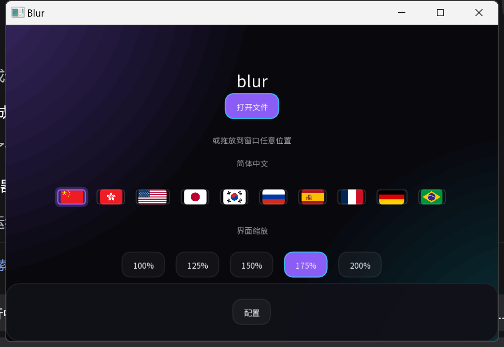

# blur · 多语言界面版

**简体中文** | [English](README.en.md) | [繁體中文](README.zh-TW.md) | [日本語](README.ja.md)

给视频加运动模糊的开源工具。原理是把视频插帧到超高帧率，再做时间域平均，效果接近真实长曝光。

本项目是 **[f0e/blur](https://github.com/f0e/blur) v2.45 的第三方分支**，在保持渲染算法完全不变的前提下，重做了界面并加入多语言支持。

[](docs/screenshots/home.png)

---

## 一、和上游的区别

| 项目 | 上游 f0e/blur | 本项目 |
| --- | --- | --- |
| 渲染算法 | — | **完全未改动**（同一份 `rendering.cpp` / `vapoursynth/*.py`） |
| 界面 | 英文、固定 13px 字号 | 重做视觉（紫青玻璃拟态）+ 高 DPI 自适应 |
| 语言 | 英文 | 10 种：简中 / 繁中 / English / 日本語 / 한국어 / Русский / Español / Français / Deutsch / Português |
| 界面缩放 | 无 | 100% / 125% / 150% / 175% / 200%，首页即可切换，默认跟随系统缩放 |
| 预览 | 上次的预览会残留 | 每次启动清空旧预览 |
| 自动更新 | 开启 | 关闭（避免被替换成上游英文版） |

## 二、下载

到 [Releases](https://github.com/SORA123k/blur/releases) 页面下载，两种任选其一：

| 类型 | 文件 | 区别 |
| --- | --- | --- |
| **安装版**（推荐） | `blur-v2.45-multilingual-setup-win64.exe` | 双击安装到当前用户目录，**不需要管理员**；自动创建桌面和开始菜单快捷方式；安装目录里有 `uninstall.cmd` 可卸载。 |
| **便携版** | `blur-v2.45-multilingual-portable-win64.zip` | 解压到任意目录（建议不含中文和空格的路径），双击 `blur-gui.exe` 直接用；不写注册表、不建快捷方式，删目录即卸载。 |

两个包内容一致，都自带运行库（FFmpeg、VapourSynth、RIFE 模型、中文字体），**不需要另装任何东西**。

### 系统要求

- Windows 10 1803+ / Windows 11，64 位
- 渲染插帧（RIFE）需要支持 Vulkan 的显卡；没有独显时会自动回退到 SVP 插帧
- 安装版依赖系统自带的 `tar.exe`（Windows 10 1803 起内置）；更老的系统请用便携版

## 三、使用方法

1. 打开软件 → 拖入视频，或点「打开文件」
2. 首页可选界面语言（点国旗）和界面缩放
3. 点「配置」进入参数页

第一次用建议：输出帧率 60、模糊量 1、权重 `equal`、开启插帧（1200fps）、开启去重。

成品输出在原视频同目录。

## 四、自行编译

完整步骤见 [docs/BUILD.md](docs/BUILD.md)。最简版本：

```bash
# 需要 Visual Studio 2022 (C++ 桌面开发) + Windows SDK + CMake + Ninja + vcpkg
git clone --recursive https://github.com/SORA123k/blur.git
cd blur
cmake -S . -B build -G Ninja \
  -DCMAKE_BUILD_TYPE=Release \
  -DCMAKE_TOOLCHAIN_FILE="$VCPKG_ROOT/scripts/buildsystems/vcpkg.cmake" \
  -DVCPKG_TARGET_TRIPLET=x64-windows-static
cmake --build build
```

> **必须用静态 triplet**：项目里写死了 `BOOST_FILESYSTEM_STATIC_LINK` 和静态 CRT，用 `x64-windows`（动态）会编译报错。
> 源码路径不能含中文——`rc.exe` 是 ANSI 程序，中文路径会导致链接阶段失败。

GitHub Actions 也在 `.github/workflows/build.yml` 里配置了自动构建，推 tag 即可产出便携包与安装包。

## 五、目录结构

```
src/                  源码（common=核心算法与配置, gui=界面, cli=命令行）
  common/i18n.cpp     多语言表与切换
  common/i18n_table.h 由 translations/*.tsv 生成的翻译表
  gui/ui/theme.h      设计 token（配色、圆角，改这一个文件即可换肤）
  gui/ui/flags.h      内嵌的真实国旗 PNG
  gui/fonts/cn_sans.h 内嵌字体子集（拉丁/西里尔/假名/谚文/中日文）
translations/         10 种语言的 .tsv 源文件
dependencies/         imgui、stb（已随仓库提供，无需 submodule）
docs/                 构建文档与截图
```

翻译改动方式：编辑 `translations/lang_*.tsv`，然后运行 `python tools/gen_i18n.py` 重新生成 `src/common/i18n_table.h`。

## 六、许可与致谢

- **本分支遵循 GPL-3.0**（与上游一致），见 [LICENSE](LICENSE)。
- 上游项目：[f0e/blur](https://github.com/f0e/blur)，作者 **f0e**。本分支非官方发布，与上游作者无隶属或背书关系；上游作者不对本分支负责，请勿到上游仓库为本分支报 issue。
- 第三方组件与字体授权见 [THIRD-PARTY-NOTICES.txt](THIRD-PARTY-NOTICES.txt) 与 `LICENSES/`。
- 界面字体：Noto Sans SC + Noto Sans KR 子集（SIL OFL 1.1）。
- 国旗图标：[flagcdn.com](https://flagcdn.com)（公有领域，源自 Wikimedia Commons）。
- 界面风格参考：[clickgui-ui](https://github.com/) 设计规范（紫青玻璃拟态）。

## 七、免责

本软件按「现状」提供，不附带任何担保（GPL-3.0 §15/§16）。这是视频处理工具，**不提供、不包含、不协助获取任何游戏本体、素材、作弊或破解内容**;素材版权由使用者自行负责。如上游权利人提出异议，收到通知即停止分发。
