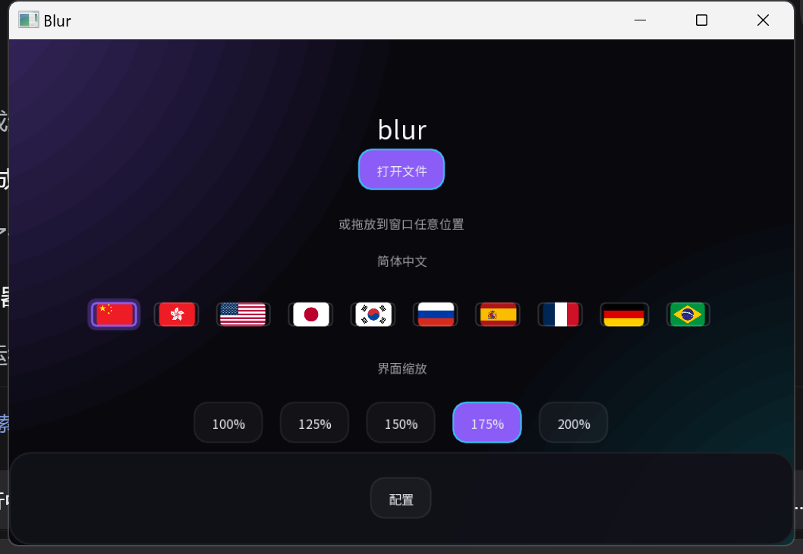

# blur · 多語言介面版

[简体中文](README.md) | [English](README.en.md) | **繁體中文** | [日本語](README.ja.md)

替影片加上動態模糊的開源工具。原理是把影片補幀到超高幀率，再做時間域平均，效果接近真實長曝光。

本專案是 **[f0e/blur](https://github.com/f0e/blur) v2.45 的第三方分支**，渲染演算法完全未更動，只重做了介面並加入多語言。

[](docs/screenshots/home.png)

## 與上游的差異

| | 上游 f0e/blur | 本分支 |
| --- | --- | --- |
| 渲染演算法 | — | **完全未變更** |
| 介面 | 英文、固定 13px | 重新設計（紫青玻璃風格）+ 高 DPI 自適應 |
| 語言 | 英文 | 10 種（含繁體中文） |
| 介面縮放 | 無 | 100%–200%，首頁即可切換 |
| 預覽 | 會殘留上次畫面 | 每次啟動清空 |
| 自動更新 | 開啟 | 關閉（避免被換成上游英文版） |

## 下載

到 [Releases](https://github.com/SORA123k/blur/releases) 下載，兩種擇一：

| 類型 | 檔案 | 差異 |
| --- | --- | --- |
| **安裝版**（推薦） | `blur-v2.45-multilingual-setup-win64.exe` | 安裝到目前使用者目錄，**不需要系統管理員**；自動建立桌面與開始功能表捷徑；安裝目錄內有 `uninstall.cmd` 可卸載。 |
| **免安裝版** | `blur-v2.45-multilingual-portable-win64.zip` | 解壓到任意目錄（建議不含中文與空白）後執行 `blur-gui.exe`；不寫登錄檔，刪除目錄即卸載。 |

兩者內容相同，皆自帶 FFmpeg、VapourSynth、RIFE 模型與字型，免另外安裝。

需求：Windows 10 1803+ / 11 64 位元；RIFE 補幀需要支援 Vulkan 的顯示卡（沒有時自動退回 SVP）。

## 使用

1. 拖入影片或點「開啟檔案」
2. 首頁選語言（點國旗）與介面縮放
3. 點「設定」調整參數

首次建議：輸出幀率 60、模糊量 1、權重 `equal`、開啟補幀（1200fps）、開啟去重。成品輸出在原始影片同目錄。

## 自行編譯

完整說明見 [docs/BUILD.md](docs/BUILD.md)。

```bash
git clone --recursive https://github.com/SORA123k/blur.git
cd blur
cmake -S . -B build -G Ninja -DCMAKE_BUILD_TYPE=Release \
  -DCMAKE_TOOLCHAIN_FILE="$VCPKG_ROOT/scripts/buildsystems/vcpkg.cmake" \
  -DVCPKG_TARGET_TRIPLET=x64-windows-static
cmake --build build
```

> 必須使用靜態 triplet（專案寫死 `BOOST_FILESYSTEM_STATIC_LINK` 與靜態 CRT）；原始碼路徑不可含中文。

## 授權與致謝

- **GPL-3.0**，與上游相同，見 [LICENSE](LICENSE)。
- 上游：[f0e/blur](https://github.com/f0e/blur)，作者 **f0e**。本分支非官方發布，與上游作者無隸屬或背書關係。
- 字型：Noto Sans SC / KR 子集（SIL OFL 1.1）；國旗：[flagcdn.com](https://flagcdn.com)（公有領域）。
- 其餘第三方元件見 [THIRD-PARTY-NOTICES.txt](THIRD-PARTY-NOTICES.txt)。
